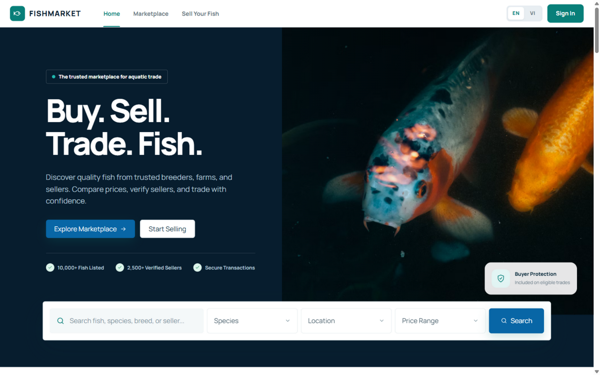
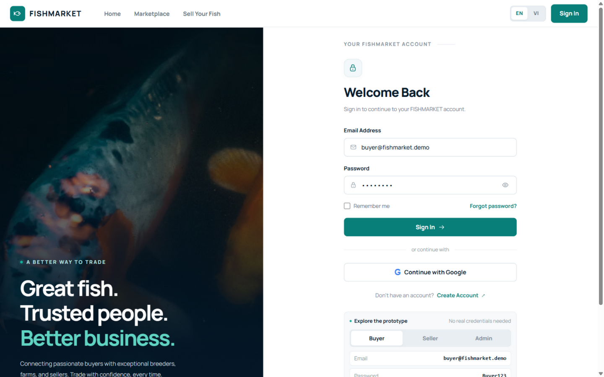
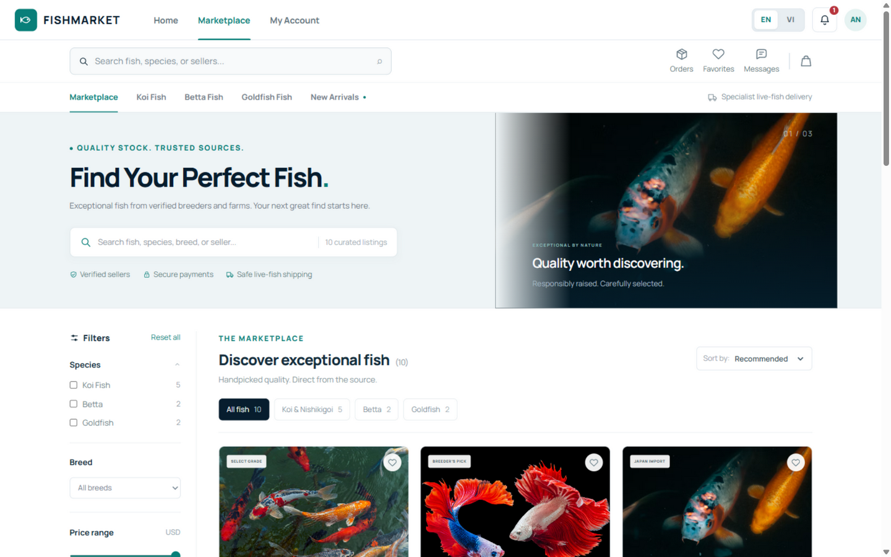
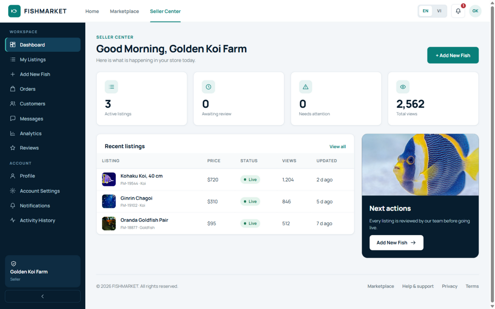
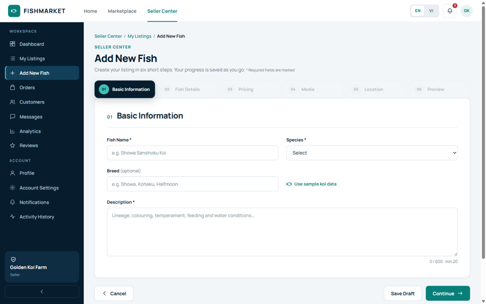
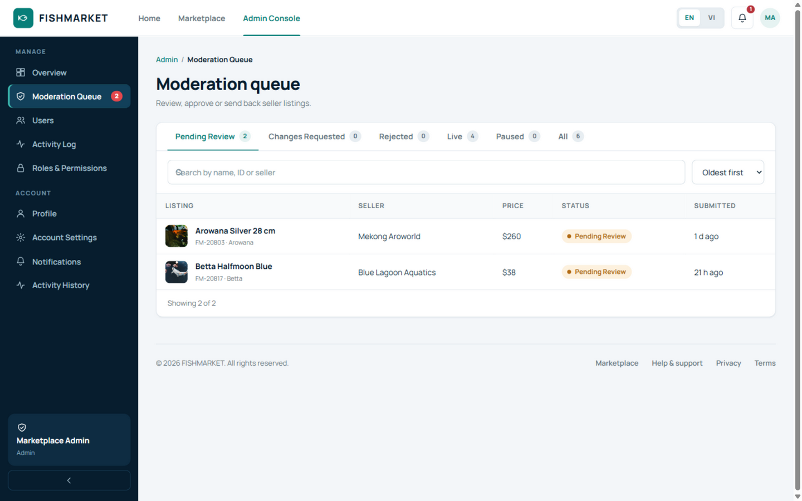
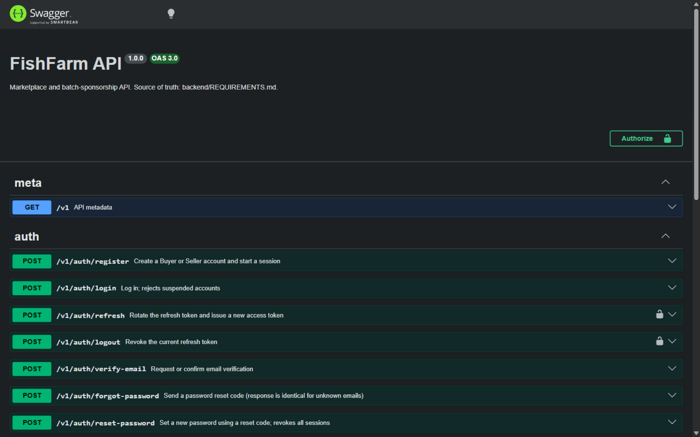

# Báo cáo tiến độ dự án FishFarm

**Repository:** [github.com/morbingman/FishFarm](https://github.com/morbingman/FishFarm)  
**Cập nhật:** 18/10/2026  
**Nhóm:** 2 người (01 frontend, 01 backend)

---

## 1. Tổng quan dự án

### Mục tiêu

- Xây dựng sàn giao dịch thủy sản cho thị trường Việt Nam, gồm ba phần:
  - **Landing page** giới thiệu sản phẩm và dịch vụ.
  - **Chợ cá** cho phép người mua tìm kiếm, đặt mua và theo dõi đơn hàng từ người bán.
  - **Tài trợ lứa cá** — khách trả trước toàn bộ chi phí nuôi (con giống, thức ăn, chăm sóc, vận chuyển), theo dõi tiến độ và nhận cá khi thu hoạch.
- Mô hình marketplace có thêm **đặt trước (pre-order)**: cọc 25% giá trị đơn, trả phần còn lại trong 7 ngày kể từ khi người bán báo cá sẵn sàng; nếu quá hạn thì hủy đơn và hoàn cọc.

### Vai trò người dùng

- **Buyer:** duyệt chợ, đặt hàng, theo dõi đơn, đánh giá, tranh chấp, tài trợ lứa cá.
- **Seller:** tạo và quản lý tin đăng, theo dõi đơn hàng, tạo lứa cá và cập nhật tiến độ nuôi.
- **Admin:** kiểm duyệt tin đăng, quản lý người dùng, xem nhật ký hoạt động, duyệt và quyết toán lứa cá.
- Quy tắc đã khóa: **chỉ Buyer được đặt hàng**; sửa tin đang bán phải được duyệt lại.

### Kiến trúc và công nghệ

- **Frontend:** React 19, Vite 8, Tailwind CSS v4, TypeScript; điều hướng bằng hash, song ngữ Anh/Việt.
- **Backend:** NestJS 12 (ESM), Prisma 7.10.1, PostgreSQL 17, REST API + Swagger/OpenAPI.
- **Xác thực:** JWT access token giữ trong bộ nhớ + refresh token xoay vòng trong httpOnly cookie; idle timeout phía server.
- **Phân quyền:** permission key phía server, mặc định từ chối mọi route trừ khi được đánh dấu công khai.
- **Dữ liệu:** tiền là số nguyên VND; thông báo và lỗi dùng message key i18n.
- **Môi trường local:** frontend cổng 8443, API cổng 4000, PostgreSQL cổng 5432.

### Hiện trạng

- Frontend đã có đầy đủ giao diện cho landing page, xác thực, Buyer, Seller, Admin và tài khoản; dữ liệu vẫn chạy bằng localStorage với độ trễ/lỗi mạng mô phỏng.
- Backend đã hoàn thành **M1 (khung hệ thống)** và **M2 (xác thực & người dùng)**; chưa nối frontend với API thật.
- Các phần chưa có UI: batch sponsorship, pre-order/đặt cọc, thanh toán thật.
- Cấu trúc repo:
  - `backend/` — API, schema Prisma, migration, seed, test.
  - `frontend/` — ứng dụng React/Vite.
  - `docs/` — báo cáo và ảnh chụp màn hình.

---

## 2. Nhật ký theo ngày

### Ngày 1 — 16/10/2026: Khởi động, hoàn thiện frontend và chốt hợp đồng dữ liệu

- Khởi tạo dự án FishFarm, thống nhất phạm vi ba phần: landing page, chợ cá và tài trợ lứa cá.
- Xác định mô hình kinh doanh: marketplace mua bán trực tiếp, pre-order với cọc 25%, và gói tài trợ trọn đời cá theo share hoặc toàn bộ lứa.
- Frontend hoàn thiện và được bàn giao dưới dạng SPA React 19 + Vite 8 + Tailwind CSS v4, route lazy-load, điều hướng hash.
- **Landing page:** hero, tìm kiếm chợ cá, danh mục, tin nổi bật, thống kê, khối uy tín/quy trình, cảm nhận cộng đồng, blog và đăng ký nhận tin.
- **Xác thực:** đăng nhập, đăng ký Buyer/Seller, xác minh email, quên/đặt lại mật khẩu, màn hình hết phiên, tài khoản demo.
- **Buyer:** duyệt chợ với bộ lọc, chi tiết tin, yêu thích, giỏ hàng, thanh toán mô phỏng, xác nhận đơn, theo dõi đơn, giao hàng, đánh giá, tranh chấp, tin nhắn, thông báo.
- **Seller Center:** dashboard KPI, bảng tin theo trạng thái, wizard 6 bước (Thông tin cơ bản → Chi tiết cá → Giá → Hình ảnh → Vị trí → Xem trước), xem trước như Buyer, gửi duyệt/gửi lại/rút/tạm ngưng/mở lại/xóa, nhận phản hồi từ Admin; các mục đơn hàng, khách hàng, tin nhắn, analytics, đánh giá là placeholder.
- **Admin Console:** dashboard KPI, hàng chờ kiểm duyệt theo tab, duyệt/yêu cầu sửa/từ chối/gỡ tin, quản lý người dùng (tìm kiếm, tạm khóa/mở khóa), nhật ký hoạt động, bảng ma trận phân quyền.
- **Tài khoản:** sửa hồ sơ, đổi mật khẩu, tùy chọn thông báo, trung tâm thông báo, lịch sử hoạt động.
- **Hành vi dùng chung:** song ngữ Anh/Việt, tự hết phiên sau 15 phút không hoạt động kèm cảnh báo, dữ liệu demo gồm 7 tài khoản và các tin đăng mẫu.
- Rà soát `frontend/src/store.ts` để rút ra hợp đồng dữ liệu backend: User, Listing + draft, Notification, Activity, Session.
- Xác định các thực thể frontend chưa có nhưng backend cần: Order/Payment, Cart, Review, Message, Favorite, Dispute, Upload, seller Customers/Analytics và toàn bộ miền batch sponsorship.
- Xác nhận frontend chưa có lời gọi API thật, chưa có UI cho batch sponsorship hoặc pre-order/đặt cọc.

### Ngày 2 — 17/10/2026: Chốt yêu cầu v1.0 và hoàn thành M1

- Chốt `backend/REQUIREMENTS.md` phiên bản 1.0, bao gồm marketplace (§1–§10) và batch sponsorship (§11).
- Khóa các quyết định: VND số nguyên, chỉ Buyer đặt hàng, sửa tin đang bán phải duyệt lại, JWT + refresh cookie httpOnly, idle timeout phía server, i18n message key.
- **M1 — khung backend:** NestJS 12 (ESM), Prisma 7.10.1, PostgreSQL 17, pnpm 12, kiểm tra biến môi trường, `/health`, Swagger tại `/docs`, prefix `/v1`, README hướng dẫn chạy.
- Thiết kế và migrate **32 model** cho danh tính, tin đăng và bản nháp, lịch sử kiểm duyệt, thông báo, hoạt động, giỏ hàng/đơn hàng/thanh toán, đánh giá, tranh chấp, upload, lứa cá, tài trợ, escrow, thu hoạch và xác minh trang trại.
- Viết seed lặp lại được: 7 người dùng (gồm tài khoản bị khóa), 7 tin đăng ở nhiều trạng thái, thông báo/hoạt động, lứa cá `BATCH-1024` có bảng chi phí và một gói tài trợ 2 share đã góp vốn với các đợt escrow.
- Cấu hình PostgreSQL 17 bằng Docker Compose; đặt API ở cổng **4000** để tránh xung đột với PlotFarm (3000/3001).
- Cấu hình CORS cho các cổng Vite của frontend (8443 và 5173).
- Xử lý các ràng buộc công cụ: ghim Prisma 7.10.1, thêm driver adapter `@prisma/adapter-pg`, cấu hình phê duyệt build cho pnpm 12.

### Ngày 3 — 18/10/2026: Hoàn thành M2, kiểm thử và bàn giao

- **M2 — xác thực và người dùng:**
  - Đăng ký, đăng nhập, refresh, đăng xuất.
  - OTP xác minh email và đặt lại mật khẩu: 6 chữ số, hạn 5 phút, chờ 45 giây mới gửi lại, tối đa 5 lần thử, lưu dạng hash; trả `devCode` ngoài production để test.
  - `/me` cho hồ sơ và `/me/prefs` cho tùy chọn thông báo.
- Phiên đăng nhập: refresh token hash, xoay token mỗi lần refresh, từ chối token cũ bị dùng lại, idle timeout trượt phía server.
- Tài khoản bị khóa bị từ chối khi đăng nhập, khi refresh và ở mọi request có xác thực.
- Thêm ma trận phân quyền phía server và guard mặc định từ chối, áp dụng quy tắc chỉ Buyer được đặt hàng.
- Thêm hợp đồng lỗi thống nhất (`statusCode`, `code`, `params`, `details`, `path`, `timestamp`) với message key i18n và ánh xạ lỗi validation.
- Ghi tài liệu auth/cookie trong Swagger và README.
- **Kiểm chứng:**
  - `pnpm build` sạch.
  - `pnpm lint` 0 cảnh báo, 0 lỗi.
  - 10 unit test pass (ma trận phân quyền, tách quyền theo vai trò, phạm vi batch).
  - 21 e2e test pass với PostgreSQL thật: đăng ký/đăng nhập, refresh rotation và replay, logout, khóa tài khoản, OTP, reset mật khẩu, giới hạn lần thử, cooldown, validation.
- Kiểm tra CPU PostgreSQL bị báo 3%: đây là sai số lấy mẫu của Docker stats; đo thực tế cả hai database đều dưới 1% một core khi rảnh, không có kết nối client.
- Bổ sung ảnh chụp màn hình vào `docs/screenshots/`, viết báo cáo và commit lên GitHub.

---

## 3. Hình ảnh minh họa

### Frontend

**Landing page**

**Đăng nhập**

**Chợ cá (Buyer)**

**Seller Center**

**Wizard đăng bán cá**

**Admin — hàng chờ kiểm duyệt**

### Backend

**Swagger — các endpoint xác thực**

---

## 4. Kiểm thử và xác minh

- `pnpm build` — biên dịch thành công.
- `pnpm lint` — 0 cảnh báo, 0 lỗi trên 36 file.
- `pnpm test` — 10 unit test pass.
- `pnpm test:e2e` — 21 e2e test pass với PostgreSQL thật; dữ liệu test được dọn dẹp sau khi chạy.
- `GET /health` trả `{"status":"ok","db":"up"}`.
- Swagger/OpenAPI hiển thị đầy đủ endpoint auth, users và health.

---

## 5. Bước tiếp theo

- **M3 — Listings core:**
  - Máy trạng thái vòng đời tin đăng: draft → pending → approved/changes/rejected, tạm ngưng/mở lại.
  - Sửa tin đang bán đưa tin về trạng thái chờ duyệt và ẩn khỏi chợ.
  - Lịch sử tin đăng, thông báo, nhật ký hoạt động.
  - CRUD cho Seller và quyết định kiểm duyệt cho Admin.
- Các milestone sau: M4 marketplace read, M5 uploads, M6 commerce, M7 engagement, M8 hardening, M9–M11 batch sponsorship.
